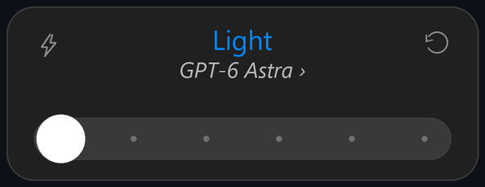

# Hey, I'm Nikolai.

I build software that turns ideas into useful tools: SaaS products, AI-powered applications, and the systems that keep them running.

## Things I've built

### [CutRank](https://github.com/qhak/cutrank)

Physique analysis, strength tracking, and practical training guidance.

*Web application · AI integration*

### [ModHorizon](https://github.com/qhak/modhorizon)

AI-assisted workflows for creating Minecraft plugins, mods, and other game assets.

*TypeScript · AI code generation*

### [Lucid Analytics](https://github.com/qhak/lucid)

Self-hosted web analytics, built on Cloudflare Workers and D1.

*JavaScript · Cloudflare Workers · D1*

---

## What I'm interested in

Backend systems · AI integrations · API design · SaaS architecture · Analytics

